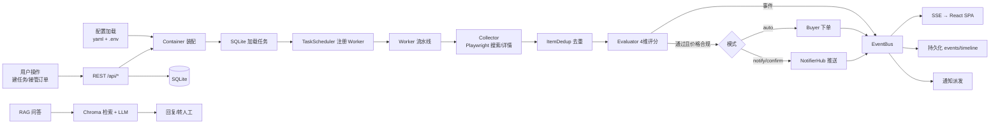

# XianyuHunter（闲鱼猎人）系统架构设计文档

| 项目 | 内容 |
|------|------|
| 文档性质 | 系统架构设计（基于源码事实编写） |
| 编写日期 | 2026-11-02 |
| 适用版本 | `xianyu-hunter` 0.4.x（pyproject 版本 `0.4.20261101.1`） |
| 项目路径 | `<项目根>` |
| 配套文档 | `docs/概要设计文档.md`（v3.0，功能级 SDD）、`docs/README.md`（文档索引） |

> 本文件基于工作空间内实际源码（`backend/`、`frontend/`、`scripts/`、`config/` 及打包配置）梳理，所有组件、模块与数据流均与代码实现一一对应，未引入任何代码中不存在的功能或组件。

---

## 1. 引言与系统概述

### 1.1 业务背景

闲鱼（Goofish）是国内最大的二手交易平台之一，商品信息更新极快、竞争激烈。XianyuHunter 是一套运行在 **Windows 桌面** 的「闲鱼自动捡漏与抢单」辅助系统：通过浏览器自动化监控关键词、增量去重、多维卖家评估、自动下单/推送，并配套 React 控制台与 RAG 智能客服，帮助用户在秒级内发现并抢购目标商品，并支持远程运维与多用户隔离。

### 1.2 核心目标

| 编号 | 目标 | 实现要点（代码对应） |
|------|------|----------------------|
| G1 | 自动发现低价商品 | `modules/collector`（Playwright 搜索） |
| G2 | 多维卖家评估 | `modules/evaluator.py`（4 维加权评分 + 一票否决） |
| G3 | 第一时间抢单 | `modules/buyer.py`（并发安全、幂等下单） |
| G4 | 即时通知 | `modules/notifier`（NotifierHub，多通道） |
| G5 | 多用户隔离 | `web/middleware/auth.py` + `web/services/user_manager.py`（按 user_id 隔离） |
| G6 | 智能客服 | `modules/chatbot`（RAG + Agent） |
| G7 | 远程/移动访问 | Tailscale Funnel / Cloudflare Tunnel + 移动端 PWA |

### 1.3 运行形态

系统存在两种运行形态，代码层面统一：
- **开发态**：`python -m xianyu_hunter web`（Typer CLI 启动 uvicorn），前端走 Vite dev server。
- **打包态**：PyInstaller 产出 `xianyu-hunter.exe`，由 `scripts/launcher.py` 作为桌面入口启动（单实例锁、端口清理、自动开浏览器），再用 Inno Setup 封装为安装包。

两种形态共用同一套 `backend/xianyu_hunter` 后端与 `frontend/` SPA，差别仅在资源路径解析（`infra/paths.py`）与是否内嵌浏览器。

### 1.4 与既有文档的关系

- 本文件是与代码保持一致的**架构视角**文档，侧重「组件边界、依赖、通信与数据流」。
- `docs/概要设计文档.md`（v3.0，2026-07-06）为功能级 SDD，覆盖面更广。经代码核对，其中个别描述已过时，本文在第 7 节「与既有文档的差异说明」中予以标注，后续以本文件为架构权威来源。

---

## 2. 总体架构

系统呈清晰的**分层 + 模块化**结构：表现层（React SPA / REST + SSE）→ Web 层（FastAPI）→ 业务模块层（`modules/`）→ 领域层（`domain/`）与基础设施层（`infra/`）→ 持久化与外部系统。核心引擎（采集、评估、抢单、调度、通知、客服）通过 **组合根 `container.py`** 以依赖注入方式装配，模块间借助 **EventBus** 做异步解耦。

```mermaid
graph TD
    subgraph 客户端
        SPA[React 18 SPA / AntD 5<br/>部署于 /xianyu]
        MOB[移动端 PWA]
    end

    subgraph Web层["Web 层 (FastAPI, backend/xianyu_hunter/web)"]
        APP[app.py 应用入口]
        ROUTES[~60 个路由模块 /api/* 与 /xianyu/api/*]
        MW[中间件: auth / request_id / security / 异常捕获]
        SVC[服务: auth_manager / cookie_* / notification_engine / user_manager / tunnel_service]
    end

    subgraph 业务模块层["业务模块层 (modules/)"]
        COL[collector 采集]
        EVAL[evaluator 评估 + price_strategy]
        BUY[buyer 抢单]
        SCH[scheduler / worker 调度]
        NOT[notifier 通知 Hub]
        ANTI[anti_detect 反检测]
        ACCT[账号/Cookie 轮换与续期]
        CHAT[chatbot RAG+Agent]
    end

    subgraph 领域与基础设施["领域层 + 基础设施层"]
        DOM[domain/ 纯模型: task/item/seller/order/evaluation/event]
        INF[infra/: repository / event_bus / browser / yaml_config / secrets / logger]
    end

    subgraph 持久化与外部["持久化与外部系统"]
        SQL[(SQLite<br/>data/xianyu.db)]
        VEC[(ChromaDB 向量库<br/>RAG 语料)]
        BROWSER[(Playwright / CDP<br/>browser-data/)]
        EXT[闲鱼(Goofish) Web]
        NOTCH[第三方通知通道<br/>Server酱/Bark/Telegram/企微/钉钉…]
        LLM[OpenAI 兼容 LLM / Embedding]
        KV[keyring / DPAPI 密钥]
    end

    SPA -->|REST + SSE| ROUTES
    MOB -->|REST + SSE| ROUTES
    ROUTES --> MW --> APP
    ROUTES --> SVC
    SVC --> 业务模块层
    COL --> EXT
    COL --> DOM
    EVAL --> DOM
    BUY --> DOM
    SCH --> COL & EVAL & BUY
    业务模块层 --> INF
    INF --> SQL & VEC & BROWSER & KV
    NOT --> NOTCH
    CHAT --> VEC & LLM
    COL -->|Cookie| BROWSER
```

---

## 3. 模块详细设计

### 3.1 分层职责

| 层 | 包/目录 | 职责 | 关键文件 |
|----|---------|------|----------|
| 表现层 | `frontend/` | React 18 + TypeScript SPA，Ant Design 5 组件，Zustand 状态管理，ECharts 可视化，react-router-dom 路由，PWA（vite-plugin-pwa + workbox） | `frontend/src/main.tsx`、`frontend/vite.config.ts` |
| Web 层 | `backend/xianyu_hunter/web/` | FastAPI 应用、路由注册、鉴权中间件、SSE 流、服务编排、启动钩子 | `web/app.py`、`web/startup.py`、`web/routes/`、`web/services/`、`web/middleware/` |
| 业务模块层 | `backend/xianyu_hunter/modules/` | 全部领域逻辑（采集/评估/抢单/调度/通知/反检测/账号/客服） | 见 3.2 |
| 领域层 | `backend/xianyu_hunter/domain/` | 无副作用的纯领域模型与枚举 | `task.py`、`item.py`、`seller.py`、`order.py`、`evaluation.py`、`notification.py`、`events.py`、`urls.py` |
| 基础设施层 | `backend/xianyu_hunter/infra/` | 数据访问、事件总线、浏览器驱动、配置、密钥、日志 | 见 3.3 |
| 组合根 | `backend/xianyu_hunter/container.py`、`config.py`、`paths.py` | 依赖装配、配置加载、路径解析 | `container.py` |

### 3.2 业务模块层（`modules/`）分组

#### 3.2.1 采集与解析 — `collector/`
- **职责**：基于 Playwright 驱动浏览器访问闲鱼，执行关键词搜索、商品详情抓取与字段解析。
- **组成**：`core.py`（编排）、`_base.py`、`_search.py`（搜索流）、`_detail.py`（详情）、`_parser.py`（字段解析）；另有 `collection_service.py`、`collector_utils.py`、`item_display_sync.py`（DB/实时双模式展示同步）。
- **依赖**：`infra/browser.BrowserManager`、反检测模块、`domain.item`。

#### 3.2.2 评估与定价 — `evaluator.py` / `price_strategy.py` / `param_calculator/`
- **职责**：对抓取商品做 4 维卖家加权评分（信用资质/职业卖家/历史纠纷/价格异常），支持 Sigmoid 扣分、一票否决、防高分掩盖；`price_strategy` 提供价格策略（硬上限/下限/市场比/TopN）；`param_calculator` 做参数校验与建议。
- **依赖**：`domain.evaluation`、`infra.repository`（评分历史、卖家趋势）。

#### 3.2.3 抢单 — `buyer.py` / `buyer_config.py`
- **职责**：在评估通过且价格符合策略时执行下单；并发安全、内存 + DB 双层幂等、价格容差校验。
- **依赖**：`domain.order`、`infra.browser`（下单页操作）、`evaluator`（价格校验）。

#### 3.2.4 调度与任务 — `scheduler.py` / `worker.py` / `dedup.py`
- **职责**：`TaskScheduler` 为**自研 asyncio 调度器**（`asyncio.create_task` + `Event` 控制启停/暂停），注册并驱动每个任务的 `TaskWorker`；`worker` 聚合「采集→评估→（抢单/通知）」流水线；`dedup.ItemDedup` 做增量去重（避免重复通知/抢单）。
- **关键**：任务级配置覆盖（全局配置 + 单任务 JSON 覆盖）在 `container.build_worker_from_raw_task` 中统一构造，CLI 与 Web 共用，避免重复逻辑。

#### 3.2.5 通知 — `notifier/`
- **职责**：`NotifierHub` 统一派发；内置 **8 个通道**：Server酱、PushPlus、Bark、Telegram、企业微信、钉钉、Ntfy、Webhook（`bark.py`/`dingtalk.py`/`telegram.py`/`wecom.py`/`serverchan.py`/`pushplus.py`/`ntfy.py`/`webhook.py`）；`quiet_hours.py`（免打扰）、`templates.py`（模板）、`registry.py`（注册表）、`models.py`（NotificationRow，含 `dedup_key` 去重）。
- **触发**：由 EventBus 消费事件后派发，支持 22 类事件订阅与 5/15/30 分钟分级。

#### 3.2.6 反检测 — `anti_detect.py` / `awsc_spoof.py` / `fingerprint.py` / `freq_disguise.py` / `mtop_signer.py` / `captcha_handler.py` / `dealer_detector.py`
- **职责**：stealth 脚本注入、awsc 签名伪造、设备指纹、Beta 分布延迟与贝塞尔曲线鼠标轨迹、mtop 签名、验证码处理、职业卖家/黄牛识别；配合配置 `antidetect` / `waf`（熔断）。

#### 3.2.7 账号与 Cookie 生命周期 — `account_rotator.py` / `cookie_rotator.py` / `cookie_sync_scheduler.py` / `token_renewer.py` / `login_orchestrator.py` / `login_strategy.py` / `session_health.py` / `proxy_pool.py`
- **职责**：账号池 + 代理池 + Cookie 三层状态机；登录后 `token_renewer` 后台续期；`cookie_sync_scheduler` 在开发态/打包态之间同步 Cookie；`session_health` 每 5 分钟健康探测；`proxy_pool` 代理管理。
- **持久化**：Cookie 存于 `browser-data/`（Playwright user_data_dir），敏感密钥经 `infra/secrets.py`（keyring + Windows DPAPI）存储。

#### 3.2.8 智能客服（RAG + Agent）— `chatbot/`
- **职责**：基于检索增强生成回答文档/任务状态/异常排查类问题。
- **组成**：`rag_engine.py`（检索）、`vector_store.py`（ChromaDB 适配，同步 API 用 `asyncio.to_thread` 包装避免阻塞）、`embedding_service.py` / `local_embedding.py` / `onnx_embedding.py`（本地 embedding，支持 ONNX Runtime 后端以减小体积）、`intent_classifier.py`（意图识别）、`faq_matcher.py`（FAQ 匹配）、`kb_manager.py` / `kb_refresh_scheduler.py`（知识库管理与定时刷新）、`agent.py` / `orchestrator.py`（Agent 编排）、`escalation.py`（转人工）、`tool_registry.py`（工具注册）、`context_manager.py`、`sanitizer.py`。
- **依赖**：ChromaDB、OpenAI 兼容 LLM/Embedding、`infra.repository.repo_chatbot`。

### 3.3 基础设施层（`infra/`）

| 组件 | 文件 | 职责 |
|------|------|------|
| 数据访问 | `repository.py` + `repo_*.py`（`repo_tasks`/`repo_items`/`repo_orders`/`repo_sellers`/`repo_evaluations`/`repo_events`/`repo_notifications`/`repo_error_logs`/`repo_links`/`repo_deps`/`repo_param_rules`/`repo_price_history`/`repo_chatbot`/`repo_batch_refresh_history`）+ `repository_base.py` | 按聚合划分的 SQLAlchemy 仓储；`db_models.py` 定义 ORM 模型与引擎工厂（`create_sqlite_engine`） |
| 事件总线 | `event_bus.py` | 异步 EventBus，解耦「业务事件 → 通知派发 / SSE / 持久化」 |
| 浏览器驱动 | `browser.py` | `BrowserManager`：Playwright，支持 CDP 模式连接系统 Edge（指纹最真实）、headless 开关、代理 |
| 配置 | `yaml_config.py` / `yaml_io.py` | YAML 配置加载（`config/config.yaml` 等）+ pydantic 校验；`config.py` 经 pydantic-settings 读 `.env` |
| 密钥 | `secrets.py` | keyring + Windows DPAPI 存储敏感配置 |
| 日志 | `logger.py` | loguru 封装 |
| 其他 | `ai_usage.py`（AI 用量统计）、`lru.py`、`request_context.py`、`selectors.py`、`item_display_sync.py` | 辅助能力 |

### 3.4 Web 层关键设计

- **入口**：`web/app.py` 注册约 60 个路由模块（`web/routes/`），以 `/api/*` 与 `/xianyu/api/*` 双前缀暴露；SPA 静态资源由 `StaticFiles` 从磁盘加载，根路径 `/xianyu` 承载 React 应用（`frontend/vite.config.ts` 的 `base: '/xianyu/'` 与 `BrowserRouter basename="/xianyu"` 对齐）。
- **中间件**：`auth`（鉴权）、`request_id`（链路追踪）、`security`、`exception_handler`、`error_capture`（错误日志捕获，写入 `error_logs` 表供 AI 上下文导出）。
- **服务**：`auth_manager`、`cookie_store`/`cookie_status`/`cookie_runtime_sync`、`notification_engine`、`menu_manager`、`user_manager`、`tunnel_service`、`search_services` 等。
- **启动钩子**（`web/startup.py`）：应用启动即拉起 调度器、Cookie 同步调度器、Cookie 健康探测（5 分钟）、批量采集调度器、KB 刷新调度器、接管超时清理调度器、预聚合调度器与 EventBus 主循环，并在关闭时优雅停止（各 scheduler 显式 `shutdown(wait=True)`）。
- **SSE**：`sse_stream.py` 等实现实时事件流（日志、时间线、KPI 推送到前端）。

### 3.5 组合根与配置

- `container.py` 为 Composition Root，将 配置 / Repository / Browser / EventBus / Evaluator / Buyer / Scheduler / Notifier 装配为 `Container`，并暴露 `build_worker_from_raw_task` 等工厂；测试可注入 fake 替换任一依赖（无反向依赖）。
- `config.py`（pydantic-settings）从绝对路径 `.env` 读取全局配置；`infra/yaml_config.py` 加载 `config/*.yaml`（业务配置）。`paths.py` 统一解析开发态与打包态（基于 `_MEIPASS` / exe 目录）的资源与数据路径。

---

## 4. 数据架构

### 4.1 存储概览

| 存储 | 技术 | 用途 | 代码位置 |
|------|------|------|----------|
| 关系型主库 | SQLite（`data/xianyu.db`） | 任务、商品、订单、卖家、评估、事件、通知、配置等结构化数据；SQLAlchemy 2.0 ORM | `infra/db_models.py`（`create_sqlite_engine("data/xianyu.db")`） |
| 辅助 SQLite | `data/app.db` / `data/xianyu_hunter.db` / `data/trace.db` | 应用配置/审计/链路追踪等辅助数据（多库拆分，具体用途以引擎定义为准） | `infra/db_models.py` 等 |
| 向量库 | ChromaDB（`PersistentClient`） | 智能客服知识库/FAQ 向量检索；持久化于应用数据目录（路径由 `paths.get_app_dir()` 解析，开发/打包不同） | `modules/chatbot/vector_store.py` |
| 浏览器态 | `browser-data/`（Playwright user_data_dir） | 登录 Cookie、浏览器上下文 | `infra/browser.py` |
| 密钥 | OS 钥匙串（keyring + Windows DPAPI） | AI Key、通知 Token 等敏感配置 | `infra/secrets.py` |
| 缓存 | `infra/lru.py`（进程内 LRU） + SQLite 快照 | 热点查询结果、预聚合 stats 快照 | `web/services/cache_scan.py`、`pre_aggregation_scheduler.py` |

> 同步 vs 异步：主引擎为 SQLAlchemy **同步**引擎（`create_engine`），`aiosqlite` 作为可用异步驱动被列为依赖（"备用"）。ChromaDB 同步 API 通过 `asyncio.to_thread` 包装为异步，避免阻塞主事件循环。

### 4.2 关键数据实体（领域模型）

`domain/` 定义纯模型：`Task`（含 `TaskMode`：notify/confirm/auto/semi_auto）、`Item`、`Seller`、`Order`（多状态机、人工接管）、`Evaluation`（4 维）、`Notification`、`Event`（数十种类型，如 `ITEM_FOUND`/`EVAL_SCORED`/`ORDER_TAKEN`/`AUTH_EXPIRED`/`WAF_BLOCKED`），以及 `param_calculator` 规则模型、`urls`（闲鱼基址）。

### 4.3 数据流图



### 4.4 缓存与一致性策略

- **去重幂等**：`ItemDedup` 保证同一商品不重复评估/通知/抢单；`Buyer` 采用内存 + DB 双层幂等防重复下单。
- **预聚合**：`pre_aggregation_scheduler` 定期将 stats 快照写入 DB，减轻实时聚合压力。
- **Cookie 一致性**：`cookie_sync_scheduler` + `cookie_runtime_sync` 保证开发态与打包态 Cookie 视图一致，避免「面板正常/搜索不可用」类状态矛盾。

---

## 5. 技术选型

### 5.1 后端技术栈

| 类别 | 技术 | 版本/说明 | 用途 |
|------|------|-----------|------|
| 语言 | Python | ≥3.10 | 主语言 |
| Web 框架 | FastAPI + Uvicorn | fastapi≥0.110 / uvicorn[standard] | REST + SSE |
| CLI | Typer | ≥0.9 | 命令行入口（`__main__.py`） |
| ORM | SQLAlchemy | ≥2.0 | 数据访问 |
| 校验/配置 | Pydantic / pydantic-settings / PyYAML | 2.5+ / 2.1+ / 6.0 | 模型与配置 |
| 浏览器自动化 | Playwright | 1.60（pin <1.61） | 采集/下单/登录 |
| HTTP 客户端 | httpx / aiohttp | 0.27+ / 3.9+ | AI 调用 / 通知推送 |
| 调度 | APScheduler（后台周期任务）+ 自研 asyncio TaskScheduler（任务级） | apscheduler≥3.10 | 任务级调度 + 周期性后台作业（批量采集 / KB 刷新 / Cookie 同步等） |
| 向量库 | ChromaDB | ≥1.0（Rust 重写，cp39-abi3 wheel） | RAG 检索 |
| 本地嵌入 | sentence-transformers | ≥5.0（bge-small-zh，构建期预置） | Embedding |
| 嵌入加速 | ONNX Runtime | 由 chromadb 间接带入 / 构建期 onnx | 打包体积优化 |
| 安全 | keyring + cryptography + tenacity | DPAPI 密钥 / Cookie AES-GCM / 重试 | 安全与韧性 |
| 日志 | loguru | 0.7 | 结构化日志 |

可选依赖：`pystray`+`pillow`（系统托盘）、`onnx`（构建期导出/量化 embedding，不进安装包）。

### 5.2 前端技术栈

| 类别 | 技术 | 说明 |
|------|------|------|
| 框架 | React 18 + TypeScript | UI 主体 |
| 构建 | Vite 5 + TypeScript 5 | `tsc -b && vite build` |
| UI 组件 | Ant Design 5 + @ant-design/icons | 控制台组件 |
| 状态 | Zustand 4 | 前端状态管理 |
| 可视化 | ECharts 5 + echarts-for-react | KPI/漏斗/分布图 |
| 路由 | react-router-dom 6 | SPA 路由（`basename="/xianyu"`） |
| 流程图 | react-flow-renderer | 拓扑/流程展示 |
| 文档渲染 | react-markdown + remark-gfm + rehype-highlight + highlight.js | 智能客服/文档展示 |
| 拖拽 | @dnd-kit/* | 多 Sheet 工作区排序 |
| 移动/PWA | vite-plugin-pwa + workbox | 离线缓存、安装到主屏 |
| 测试 | Vitest + Testing Library | 单元/组件测试 |

> 注意：前端为**单一 React SPA**，构建产物由后端以静态资源形式从磁盘加载；源码中**未使用** htmx / Alpine.js（既有 `概要设计文档.md` 所述「双前端」已过时，见第 7 节）。

### 5.3 第三方外部服务

- **LLM / Embedding**：OpenAI 兼容接口（`openai_base_url` 可配，支持 DeepSeek/智谱等；Embedding 可独立配置 endpoint）。
- **通知通道**：Server酱、PushPlus、Bark、Telegram、企业微信、钉钉、Ntfy、自定义 Webhook。
- **闲鱼（Goofish）**：采集与下单的目标站点（通过浏览器自动化，非官方 API）。
- **远程隧道**：Cloudflare Tunnel（cloudflared / cpolar）、Tailscale Funnel（零配置内网穿透）。

---

## 6. 部署与运维架构

### 6.1 两种运行形态

```mermaid
graph LR
    DEV[开发态<br/>python -m xianyu_hunter web] --> UV[uvicorn + Vite dev]
    PKG[打包态<br/>xianyu-hunter.exe] --> LAUNCH[scripts/launcher.py<br/>单实例锁/端口清理/自动开浏览器]
    LAUNCH --> UV2[uvicorn(内嵌)]
    UV --> APP[FastAPI 应用]
    UV2 --> APP
    APP --> SPA[(static/spa<br/>React 构建产物)]
```

### 6.2 桌面打包链路

- **PyInstaller**（`xianyu-hunter.spec`，**onedir** 模式，`name='xianyu-hunter'`，`console=True`，图标 `assets/xianyu-hunter.ico`，`upx=True`）：`hiddenimports` 显式收集 `chromadb` / `onnxruntime` / `tokenizers` / `sentence_transformers` / `duckdb` 等；`datas=[]`（资源在运行时从磁盘/`_MEIPASS` 解析，SPA 由 `build-exe.ps1` 复制到 `release/xianyu-hunter/static/spa`）。
- **Inno Setup**（`installer.iss`）：`AppName=XianyuHunter`，`OutputDir=release`，产物 `XianyuHunter-Setup-v{版本}`，图标同 `assets/xianyu-hunter.ico`，`PrivilegesRequired=admin`。
- **编排脚本**：`scripts/build-exe.ps1`、`build-publish.ps1`、`publish-release.py`、`config.publish.json`；便捷入口 `一键发布.bat` / `构建打包.bat` / `启动服务.bat` / `停止服务.bat` / `前端构建.bat` / `环境配置.bat`。
- **桌面启动器**（`scripts/launcher.py`）：设置 `PLAYWRIGHT_BROWSERS_PATH`、`SENTENCE_TRANSFORMERS_HOME` 等环境变量；用 `kernel32.CreateMutexW` 做单实例锁；端口清理（仅强杀本应用映像 `xianyu-hunter.exe`/`python.exe`，不误杀用户其他进程）；启动 uvicorn 并自动打开浏览器至 `http://<host>:<port>/xianyu`。

### 6.3 远程访问与移动端

- **内网穿透**：`web/services/tunnel_service.py` + `tunnel_providers.py` 提供 Cloudflare Tunnel（`CloudflareProvider`，支持 quick/named 两种模式）与 Tailscale Funnel；`api_tunnel` 暴露管理接口，`tunnel_notifications` 推送隧道状态。
- **移动端 PWA**：前端经 `vite-plugin-pwa`（workbox）生成 Service Worker，支持安装到主屏、响应式布局、关键功能移动化与半自动抢单确认。

### 6.4 可观测性与运维

- **日志/事件**：loguru 结构化日志；`error_logs` 表由 `error_capture` 中间件写入，支持 AI 上下文导出；`events` 表 + 时间线（SSE 实时流）。
- **健康检查**：`web/app.py` 的 healthz 检查 DB 连通性（`SELECT 1`）与登录态（`CookieStore.has_valid_cookies()`）。
- **静态分析**：`scripts/run_sonar.bat`、`sonar_fetch.py`、`sonar_critical.py` 集成 SonarQube；`scripts/verify.ps1`、`visual_gate.py` 等质量门禁。
- **多用户**：`auth` 中间件 + `user_manager` 实现身份识别、会话签发、滑动续期与按 `user_id` 的数据隔离。

---

## 7. 与既有文档的差异说明（过时项标注）

经与 `docs/概要设计文档.md`（v3.0，2026-07-06）逐条核对，以下描述已与当前代码不符，以本文为准：

1. **前端形态**：既有文档称「FastAPI + React 18 SPA + htmx + Alpine.js 双前端」。当前 `frontend/package.json` 仅含 React 18 + Vite + AntD 5 + Zustand，**无 htmx / Alpine.js**；前端为单一 SPA，由后端以静态资源加载。
2. **Scheduler 描述**：既有文档概述为通用调度；代码中明确为 `modules/scheduler.py`（TaskScheduler，基于 APScheduler）+ 每任务 `TaskWorker`，并经 `container.build_worker_from_raw_task` 统一装配。
3. **架构视角补充**：既有 SDD 偏功能与接口，本文补齐「分层边界、组合根 DI、EventBus 异步解耦、打包/部署链路、隧道与 PWA」等架构层面内容，并以 Mermaid 图表达拓扑与数据流。

> 其余功能级描述（监控能力、4 维评估、8 通道通知、反检测手段、多账号轮换、RAG 客服等）在既有文档与新代码层面一致，本文不再复述，保留既有 SDD 作为功能权威。

---

## 8. 关键设计决策（摘要）

- **组合根而非隐式全局**：依赖统一在 `container.py` 装配，避免层间反向依赖（曾修复 `C-01` 违例）。
- **EventBus 异步解耦**：业务事件（评估/下单/异常）统一入总线，分别驱动 SSE、持久化与通知，降低模块耦合。
- **本地化 Embedding + ONNX 后端**：RAG 向量化在本地完成（bge-small-zh），并提供 ONNX Runtime 后端以削减安装包体积（参见构建期 `onnx` 依赖仅用于导出/量化，不进安装包）。
- **CDP 浏览器模式**：`BrowserManager` 连接系统 Edge（CDP），指纹最真实，优于内置无头 Chromium。
- **开发/打包路径统一**：`paths.py` 抽象资源与数据路径，使同一份代码在源码态与 PyInstaller 打包态行为一致。
- **安全优先的删除/清理**：项目在沙箱与桌面环境均对文件删除做了显式守卫（如 `safe-delete`），运维脚本以 `.NET`/PowerShell 直接调用绕过，避免误删。
